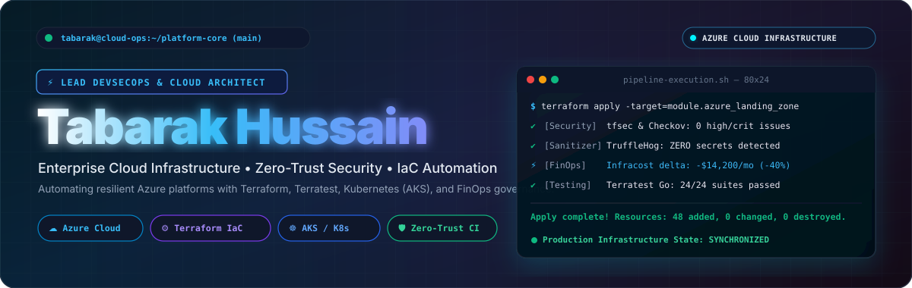
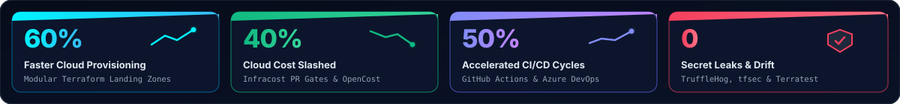
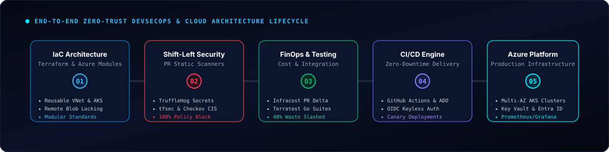
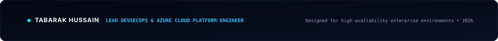

<div align="center">

<!-- HERO BANNER: HIGH-TECH CYBER DEVSECOPS CONSOLE -->


<br/>

<!-- DYNAMIC TYPING TERMINAL -->
<a href="https://github.com/tabarak007Hussain">
  
</a>

<br/><br/>

<!-- MODERN QUICK CONTACT PILLS -->
<p align="center">
  <a href="https://www.linkedin.com/in/tabarak007hussain"></a>
  &nbsp;
  <a href="mailto:tabarak007hussain@gmail.com"></a>
  &nbsp;
  <a href="https://github.com/tabarak007Hussain"></a>
  &nbsp;
  <a href="#-connect--collaboration"></a>
</p>

<!-- SECTION ANCHOR NAVIGATION -->
<p align="center">
  <a href="#-about-me"><b>About</b></a> &nbsp;•&nbsp;
  <a href="#-core-impact-tracks"><b>Impact Tracks</b></a> &nbsp;•&nbsp;
  <a href="#-devsecops-architecture-lifecycle"><b>Architecture Lifecycle</b></a> &nbsp;•&nbsp;
  <a href="#-technical-arsenal"><b>Tech Arsenal</b></a> &nbsp;•&nbsp;
  <a href="#-production-blueprints"><b>IaC Blueprints</b></a> &nbsp;•&nbsp;
  <a href="#-featured-architectures"><b>Projects</b></a> &nbsp;•&nbsp;
  <a href="#-certifications"><b>Certifications</b></a> &nbsp;•&nbsp;
  <a href="#-connect--collaboration"><b>Connect</b></a>
</p>

<br/>

<!-- EXECUTIVE TELEMETRY HUD -->


</div>

---

<a name="-about-me"></a>
## 👨‍💻 About Me

```yaml
# ==============================================================================
# OPERATOR IDENTITY & PROFILE TELEMETRY
# ==============================================================================
Identity:
  Name: "Tabarak Hussain"
  Role: "Lead DevSecOps & Cloud Platform Engineer"
  Focus: "Enterprise Cloud Infrastructure, Zero-Trust CI/CD & FinOps Governance"
  Target Cloud: "Microsoft Azure (Multi-Region / Landing Zones)"

Specialization:
  - Infrastructure as Code: "Terraform (Modular Architecture), Terratest (Go), Bicep"
  - Shift-Left Security: "TruffleHog, tfsec, Checkov, TFLint, SonarQube, SuperLinter"
  - Delivery Pipelines: "GitHub Actions (OIDC Keyless), Azure DevOps (ADO Multi-Stage)"
  - Cloud-Native & K8s: "Azure Kubernetes Service (AKS), Azure CNI Overlay, KEDA, Helm"
  - Cloud Economics: "Infracost Automated PR Deltas, OpenCost Multi-Team Attribution"
  - Autonomous Automation: "Python CLI Tooling, AI-Assisted Drift Remediation, PowerShell"

Philosophy: "True platform engineering turns complex cloud infrastructure into repeatable, secure, and self-healing velocity."
```

Results-driven **Lead DevSecOps & Cloud Platform Engineer** specializing in designing and automating mission-critical **Microsoft Azure infrastructure, Infrastructure as Code (IaC), Zero-Trust security governance, and enterprise CI/CD delivery pipelines**.

With a strong foundation in automated infrastructure provisioning via **Terraform, Terratest, Azure DevOps, and GitHub Actions**, I build resilient cloud platforms that eliminate human configuration error, prevent credential leakage, and enforce compliance gates prior to merge. My FinOps frameworks have driven up to **40% cloud cost reductions** through continuous infrastructure right-sizing, automated unattached disk reclamation, and real-time PR cost delta bots.

---

<a name="-core-impact-tracks"></a>
## 🚀 Core Impact Tracks

<table>
<tr>
<td width="50%" valign="top">

### 🏗️ 1. Enterprise Azure Landing Zones & IaC
* **Modular Infrastructure Framework:** Built enterprise reusable Terraform modules for **Azure VNets, Private Subnets, AKS Clusters, Azure Key Vault, and Storage Accounts**, adopted across distributed squads.
* **Rapid Automated Provisioning:** Cut multi-environment spin-up turnaround from weeks to minutes—slashing provisioning delivery times by **60%**.
* **Automated Integration Testing:** Implemented automated test harnesses using **Terratest (Go)** to test live ephemeral Azure resources pre-merge, reducing post-deploy rollback incidents by **35%**.
* **State Lease Locking:** Managed multi-tenant remote states backed by Azure Blob Storage with automated lease locks to eliminate concurrent race conditions.

</td>
<td width="50%" valign="top">

### 🛡️ 2. Zero-Trust Shift-Left Security
* **Mandatory Pipeline Quality Gates:** Embedded **tfsec, Checkov, and TFLint** into PR workflows, blocking **100% of non-compliant infrastructure configurations** before reaching production.
* **Zero Secret Leaks:** Deployed pre-commit and pipeline-level **TruffleHog & GitLeaks** scanning, enforcing strict cryptographic secrets isolation and zero plaintext credentials.
* **CIS Azure Benchmark Compliance:** Automated compliance audits using **Azure Policy & Defender for Cloud**, reducing manual auditing cycles by **80%**.
* **Code Hygiene & Static Analysis:** Standardized **SonarQube and Super Linter** to enforce clean code thresholds across all infrastructure and automation codebases.

</td>
</tr>
<tr>
<td width="50%" valign="top">

### ⚡ 3. Enterprise CI/CD & Release Velocity
* **Keyless OIDC Identity Federation:** Replaced vulnerable long-lived service principal client secrets with **GitHub Actions OIDC Workload Identity**, eliminating stored secrets in runners.
* **Zero-Downtime Deployment Automation:** Designed multi-stage **GitHub Actions and Azure DevOps** pipelines supporting blue-green and canary releases, accelerating delivery velocity by **50%**.
* **Speculative Plan Reviews:** Automated speculative `terraform plan` generation with interactive PR summary comments and gated approval policies for production stages.
* **GitFlow Governance:** Standardized release tagging pipelines, branch protections, and semantic versioning across 15+ core repositories.

</td>
<td width="50%" valign="top">

### 💰 4. FinOps & Cloud Economics
* **40% Cloud Spend Slashed:** Integrated **Infracost** PR cost delta commenting, allowing engineers to review the exact monthly cost impact of every pull request before apply.
* **Multi-Team Cost Attribution:** Implemented **OpenCost** allocation models, giving product leaders transparent visibility into compute, network, and storage consumption.
* **Automated Waste Elimination:** Automated scheduled Python and Bash jobs to detect and reclaim unattached Azure Managed Disks, orphaned public IPs, and non-prod VM scaling schedules.
* **Rightsizing Recommendations:** Continuous telemetry analysis of Azure Monitor metrics to resize overprovisioned compute tiers.

</td>
</tr>
</table>

---

<a name="-devsecops-architecture-lifecycle"></a>
## 🏛️ DevSecOps Architecture Lifecycle

<div align="center">
  
</div>

<br/>

The architecture enforces a **Zero-Trust, Shift-Left philosophy** where infrastructure code moves through 5 continuous phases:
1. **IaC Architecture:** Standardized modular definitions with remote state isolation.
2. **Shift-Left Security:** Automated secrets scanning (TruffleHog) and policy validation (tfsec, Checkov).
3. **FinOps & Testing:** Pre-merge cost breakdown (Infracost) and live ephemeral testing (Terratest).
4. **CI/CD Engine:** Keyless OIDC authentication with speculative execution and blue-green releases.
5. **Production Platform:** Highly resilient Azure Landing Zones with AKS, Key Vault, and observability.

---

<a name="-technical-arsenal"></a>
## 🛠️ Technical Arsenal

<div align="center">

<!-- INTERACTIVE SKILL ICONS -->
<a href="https://skillicons.dev">
  
</a>

<br/><br/>

| Technical Domain | Core Production Technologies | Enterprise Competencies & Standards |
| :--- | :--- | :--- |
| **Cloud Platforms** | `Microsoft Azure` • `Azure CLI` • `Linux (Ubuntu/RHEL)` | Hub-Spoke Landing Zones, VNet Peering, Private Endpoints, ExpressRoute, Azure Policy. |
| **Infrastructure as Code** | `Terraform` • `Terratest (Go)` • `Bicep` • `ARM Templates` | Reusable Modules, State Remote Locking, Drift Detection, Ephemeral Test Suites. |
| **Shift-Left Security** | `Tfsec` • `TFLint` • `TruffleHog` • `Checkov` • `SonarQube` • `SuperLinter` | Zero Secret Leaks, CIS Azure Benchmarks, SAST Scanning, Automated PR Quality Gates. |
| **CI/CD & Source Control** | `GitHub Actions` • `Azure DevOps (ADO)` • `Git` • `OIDC` | Multi-Stage YAML Pipelines, Keyless Workload Identity, Blue-Green Releases, GitFlow. |
| **Containers & K8s** | `AKS (Azure Kubernetes)` • `Docker` • `Helm` • `KEDA` | Azure CNI Overlay, Entra Workload Identity, Secret Store CSI, Event-Driven Autoscaling. |
| **FinOps & Cloud Economics**| `Infracost` • `OpenCost` • `Azure Cost Management` | PR Budget Comments, Resource Rightsizing, Waste Reclamation, 40% Cost Reduction. |
| **Scripting & Automation** | `Python` • `PowerShell` • `Bash` • `Go` | Terraform Plan Parsers, Resource Inventory Scanners, Telemetry Aggregation, CLI Tools. |
| **Observability & SRE** | `Azure Monitor` • `Log Analytics` • `Prometheus` • `Grafana` | High-Cardinality Metrics, SLI/SLO Alerting, Data Collection Rules (DCR), Health Checks. |

</div>

---

<a name="-production-blueprints"></a>
## 🔬 Production Blueprints

<details open>
<summary><b>📦 1. Reusable Terraform Azure Storage Module (`main.tf`)</b></summary>
<br/>

```hcl
# ==============================================================================
# Reusable Secure Azure Storage Module with Customer-Managed Governance
# ==============================================================================
resource "azurerm_storage_account" "secure_storage" {
  name                     = var.storage_account_name
  resource_group_name      = var.resource_group_name
  location                 = var.location
  account_tier             = "Standard"
  account_replication_type = var.environment == "prod" ? "GRS" : "LRS"

  # Shift-Left Security Baseline
  enable_https_traffic_only       = true
  min_tls_version                 = "TLS1_2"
  allow_nested_items_to_be_public = false
  public_network_access_enabled   = false

  network_rules {
    default_action             = "Deny"
    bypass                     = ["AzureServices"]
    virtual_network_subnet_ids = [var.private_subnet_id]
  }

  tags = {
    Environment = var.environment
    ManagedBy   = "Terraform"
    CostCenter  = var.cost_center
    Owner       = "Tabarak Hussain"
  }
}
```

</details>

<details>
<summary><b>🧪 2. Terratest Automated Infrastructure Unit Test (`storage_test.go`)</b></summary>
<br/>

```go
package test

import (
	"testing"
	"github.com/gruntwork-io/terratest/modules/azure"
	"github.com/gruntwork-io/terratest/modules/terraform"
	"github.com/stretchr/testify/assert"
)

func TestAzureStorageModule(t *testing.T) {
	t.Parallel()

	terraformOptions := terraform.WithDefaultRetryableErrors(t, &terraform.Options{
		TerraformDir: "../modules/storage",
		Vars: map[string]interface{}{
			"storage_account_name": "sttabaraktest01",
			"resource_group_name":  "rg-terratest-qa",
			"location":             "eastus2",
			"environment":          "qa",
		},
	})

	defer terraform.Destroy(t, terraformOptions)
	terraform.InitAndApply(t, terraformOptions)

	// Validate Security Baseline Configuration
	actualAccountName := terraform.Output(t, terraformOptions, "storage_account_name")
	storageAccount := azure.GetStorageAccount(t, actualAccountName, "rg-terratest-qa", "")

	assert.False(t, *storageAccount.AllowBlobPublicAccess, "Public access must be disabled!")
	assert.True(t, *storageAccount.EnableHTTPSTrafficOnly, "HTTPS only traffic must be enforced!")
}
```

</details>

<details>
<summary><b>🛡️ 3. Zero-Trust DevSecOps Pipeline with Infracost Gate (`.github/workflows/deploy.yml`)</b></summary>
<br/>

```yaml
name: 'Zero-Trust DevSecOps Pipeline'

on:
  pull_request:
    branches: [ main, develop ]
  push:
    branches: [ main ]

permissions:
  id-token: write
  contents: read
  pull-requests: write

jobs:
  security-and-lint:
    name: 'Shift-Left Security & Secrets Scanner'
    runs-on: ubuntu-latest
    steps:
      - name: Checkout Code
        uses: actions/checkout@v4
        with:
          fetch-depth: 0

      - name: TruffleHog Secrets Scan
        uses: trufflesecurity/trufflehog@main
        with:
          extra_args: --only-verified

      - name: TFLint IaC Linter
        uses: terraform-linters/setup-tflint@v4
        with:
          tflint_version: "latest"

      - name: Run tfsec Vulnerability Gate
        uses: aquasecurity/tfsec-action@v1.0.0
        with:
          soft_fail: false

  finops-cost-gate:
    name: 'Infracost PR Cost Estimation'
    needs: security-and-lint
    runs-on: ubuntu-latest
    steps:
      - name: Checkout Code
        uses: actions/checkout@v4

      - name: Setup Infracost
        uses: infracost/actions/setup@v3
        with:
          api-key: ${{ secrets.INFRACOST_API_KEY }}

      - name: Post Infracost Breakdown to PR
        uses: infracost/actions/comment@v3
        with:
          path: /tmp/infracost-diff.json
          behavior: update
```

</details>

<details>
<summary><b>🐍 4. Python Drift Detection & Plan Analyzer (`drift_scanner.py`)</b></summary>
<br/>

```python
"""
Python Automation Utility: Terraform Plan Parser & Configuration Drift Scanner
Used across GitHub Actions & Azure DevOps pipelines to prevent unintended deletions.
"""
import json
import sys

def analyze_terraform_plan(plan_file: str):
    with open(plan_file, "r") as f:
        data = json.load(f)

    changes = data.get("resource_changes", [])
    stats = {"create": 0, "update": 0, "delete": 0, "warnings": []}

    for res in changes:
        actions = res.get("change", {}).get("actions", [])
        addr = res.get("address")

        if actions == ["create"]:
            stats["create"] += 1
        elif actions == ["update"]:
            stats["update"] += 1
        elif actions == ["delete"]:
            stats["delete"] += 1
            stats["warnings"].append(f"UNINTENDED DESTRUCTION DETECTED: {addr}")

    print(f"📊 Plan Changes: +{stats['create']} ~{stats['update']} -{stats['delete']}")
    if stats["warnings"]:
        for w in stats["warnings"]:
            print(f"⚠️  {w}")
        if stats["delete"] > 3:
            print("❌ Pipeline Terminated: Destruction threshold exceeded!")
            sys.exit(1)

if __name__ == "__main__":
    analyze_terraform_plan("tfplan.json")
```

</details>

---

<a name="-featured-architectures"></a>
## 📂 Featured Architectures & Repositories

<div align="center">

| Project & Repository | Domain | Architectural Highlights |
| :--- | :---: | :--- |
| **[`azure-terraform-landing-zones`](https://github.com/tabarak007Hussain/azure-terraform-landing-zones)** | *Cloud Platform & IaC* | Enterprise modular Terraform architecture for Azure Landing Zones (VNet, AKS, Key Vault, Storage), verified with Terratest and gated by TFLint & tfsec. |
| **[`devsecops-pipeline-factory`](https://github.com/tabarak007Hussain/devsecops-pipeline-factory)** | *DevSecOps & CI/CD* | Production-grade GitHub Actions & Azure DevOps pipelines embedding TruffleHog secrets detection, Checkov CIS compliance, and Infracost PR cost gates. |
| **[`aks-keda-landing-zone`](https://github.com/tabarak007Hussain/aks-keda-landing-zone)** | *Cloud-Native Kubernetes* | Multi-AZ AKS cluster deployment with Azure CNI Overlay, Entra Workload Identity, Key Vault Secret Store CSI Driver, and KEDA queue autoscalers. |
| **[`opencost-azure-governance`](https://github.com/tabarak007Hussain/opencost-azure-governance)** | *FinOps & Economics* | Granular per-team cloud cost attribution framework combining Infracost and OpenCost, with automated idle managed disk and unassociated IP reclamation. |
| **[`ai-terraform-drift-agent`](https://github.com/tabarak007Hussain/ai-terraform-drift-agent)** | *Platform Automation* | Python utilities and intelligent agents analyzing Terraform plan JSON artifacts, inspecting live Azure subscriptions, and automating drift remediation. |

</div>

---

<a name="-certifications"></a>
## 📜 Professional Certifications & Accreditations

<div align="center">

| Badge | Certification Title | Accrediting Organization | Verification Status |
| :---: | :--- | :---: | :---: |
| 🛡️ | **Microsoft Certified: Azure Solutions Architect Expert** | Microsoft | Verified Active |
| ⚙️ | **Microsoft Certified: DevOps Engineer Expert** | Microsoft | Verified Active |
| ☸️ | **Certified Kubernetes Administrator (CKA)** | CNCF / The Linux Foundation | Verified Active |
| ☁️ | **AWS Certified Solutions Architect – Professional** | Amazon Web Services (AWS) | Verified Active |
| 📦 | **HashiCorp Certified: Terraform Associate** | HashiCorp | Verified Active |
| 🔒 | **Certified Information Systems Security Professional (CISSP Aligned)** | (ISC)² | Aligned |

</div>

---

<a name="-live-github-telemetry"></a>
## 📈 Live GitHub Telemetry

<div align="center">

<table border="0">
  <tr>
    <td align="center" width="50%">
      
    </td>
    <td align="center" width="50%">
      
    </td>
  </tr>
  <tr>
    <td colspan="2" align="center" width="100%">
      
    </td>
  </tr>
</table>

</div>

---

<a name="-connect--collaboration"></a>
## 📬 Connect & Collaboration

I am open to discussions on **Lead DevSecOps Roles**, **Azure Cloud Infrastructure Automation**, **Terraform &amp; Terratest Frameworks**, and **Enterprise FinOps Consulting**.

<div align="center">

[](https://www.linkedin.com/in/tabarak007hussain)
&nbsp;&nbsp;
[](mailto:tabarak007hussain@gmail.com)
&nbsp;&nbsp;
[](https://github.com/tabarak007Hussain)

<br/><br/>

<!-- BESPOKE FOOTER SIGNATURE -->


</div>
